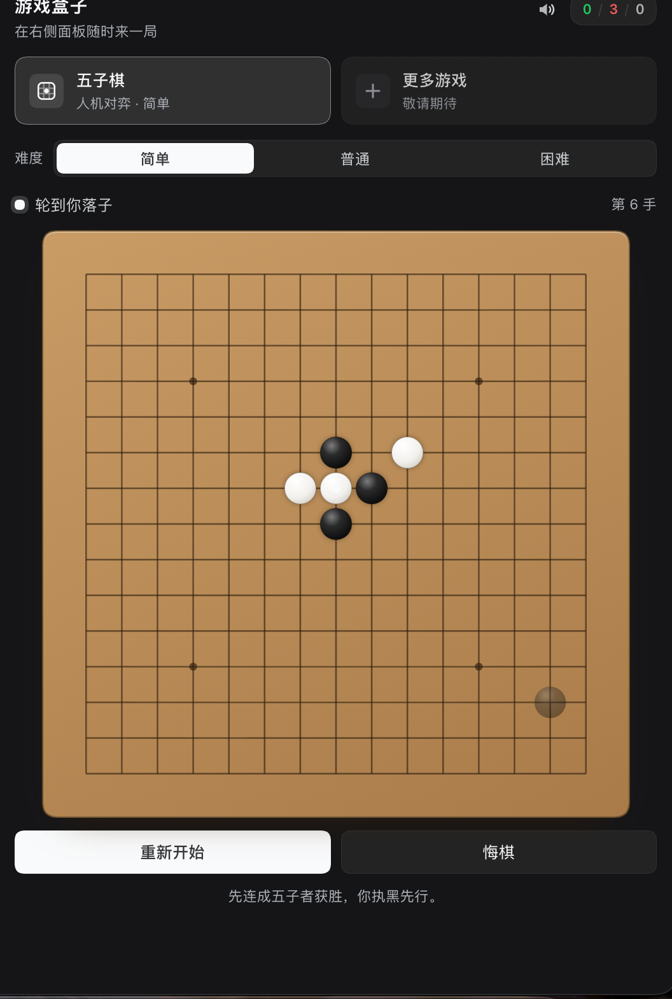

# dsh-minigames · 游戏盒子

[](https://dshopen.org/zh/plugins/dsh-minigames/)

Listed in the [Open Plugin Market](https://dshopen.org/zh/plugins/dsh-minigames/)
as a community plugin (index source: `https://dshopen.org/index.json`).

A mini-games box for the DSH Web right sidebar. It ships two games:

- **Gomoku (五子棋)** against the built-in AI in three difficulties; winning
  triggers a frame-wide celebration with confetti, fireworks and a trophy card.
- **Sky shooter (打飞机)** — a WeChat-style arcade shooter: drag your plane,
  dodge the descending enemies, auto-fire, chase a personal best.
- **Flappy whale (鲸鱼飞飞)** — an underwater Flappy-Bird style game where the
  bird is the DSH whale: click or press Space to swim up through coral gaps.

## Install

Requires DSH `0.2.2-rc.1` or newer with the Web client (the right-sidebar plugin
seats). Install from the public repository:

```bash
dsh plugin --profile web add 'github:feiniao1933/dsh-minigames'
```

To pin the reviewed revision:

```bash
dsh plugin --profile web add 'github:feiniao1933/dsh-minigames#<commit-sha>'
```

Restart `dsh web` if the running page does not pick the new bundle up. The
plugin's row id is `minigames-box`; it can be disabled again with
`dsh plugin --profile web remove dsh-minigames`.

## Screenshots

The game box in the right sidebar (dark theme) with Gomoku: game shelf,
difficulty selector, sound toggle, local tally, board, and the restart/undo
controls.



Captures of the sky shooter and the victory celebration are still to come.
The repository ships no mock-up images.

## Where it lives

The plugin contributes one **right-sidebar tab type** and one **Start-page
capsule**, so it behaves like the rest of the right sidebar rather than floating
above it:

Two ways in, both backed by the same tab type:

- **Composer toolbar (fastest):** click the small board icon at the left of the
  composer tool row (next to the attach controls). It opens the right sidebar and
  the game box in one click, even when the panel is closed.
- **Start page:** open the right sidebar (the panel button in the conversation
  header), then on the **Start** page pick the **游戏盒子 / Mini games box**
  capsule. If the panel is parked on another tab, the "+" control in its tab
  strip reopens the Start page.

The game opens as a tab in the right sidebar: a game shelf at the top (五子棋 /
打飞机 / 鲸鱼飞飞), the selected game below it, and "more games" placeholder row.
Switching games keeps every game's state while the tab stays open.

Because it is a regular tab type, it can be split, floated or moved between
panes with the sidebar's own controls, and it stays mounted while hidden.

## Gomoku

- You play **black** and move first; the AI plays white.
- **Difficulty is selectable** in the page (`简单 / 普通 / 困难`, default `困难`)
  and remembered in `localStorage`. It is a search ladder over one engine:
  easy = 2-ply, normal = 4-ply, hard = 6-ply; every level still takes its own
  wins and blocks an immediate loss.
- **Placement sounds** are synthesized with the Web Audio API (a short wooden
  clack, slightly lower for white) — no audio assets. The speaker button in the
  page header mutes them and remembers the choice; a muted game also skips the
  victory chime.
- Click an intersection, or focus the board and use the arrow keys plus Enter.
- **重新开始 / New game** starts over, **悔棋 / Undo** takes back your last move
  and the AI reply. The difficulty switch applies from the AI's next move and
  keeps the current board.
- **Progress is remembered:** the board, move history, result and elapsed time
  are saved to `localStorage` after every move, so closing the tab or reloading
  the page resumes the same game (a finished game reopens on its result, and a
  restart clears the save). A malformed save falls back to a fresh board.
- The win/loss/draw tally is kept per browser in `localStorage`.
- Winning shows the victory layer: falling confetti, three firework bursts, a
  rotating golden halo, the trophy card with move/time stats, and **Play again**.
  It dismisses itself after a few seconds, on **Escape**, or on its own buttons.
  Reduced-motion preferences turn the animation off.

All UI copy is routed through the Client locale service (English and Chinese
dictionaries); every non-artwork colour is a `--dsw-alias-*` theme token, so the
page follows light/dark themes. The board wood, stones, trophy and confetti
palette are artwork colours.

## Sky shooter

A compact remake of the classic WeChat airplane game, rendered on a `<canvas>`
inside the same right-sidebar page.

- **Drag anywhere on the screen** to move your plane (arrow keys / WASD work
  too); bullets fire automatically.
- Enemies descend in waves — small scouts, drifting fighters and slow heavy
  bombers with a health bar. Shooting one scores 10 / 35 / 120 points.
- **Enemies shoot back:** fighters fire a single aimed bullet every ~1.5–2.4 s;
  heavies fire a three-way spread every ~2–3 s. Their reload shortens as the run
  goes on. Dodge the warm-orange dots — the player hitbox against bullets is
  deliberately smaller than the plane.
- You have **3 lives**; a collision or an enemy bullet costs one and grants
  brief invulnerability. At zero lives the run ends and the **best score** is
  kept in `localStorage`.
- A short pause overlay appears when you switch games or the tab is hidden;
  resume or restart from there. Mute silences arcade sound effects (including
  the enemy-fire blip) too.

## Flappy whale

An underwater Flappy-Bird remake where the bird is the DSH whale.

- **Click / tap anywhere on the screen or press Space / ↑ / W** to swim up; the
  whale sinks under gravity between taps. Arrow keys on the board work too.
- Swim through the gaps between coral columns; each gap passed scores one
  point and the current speed slowly increases. Touching a column or the seabed
  ends the run.
- The scene is underwater: light shafts, rising bubbles, a wavy seabed with
  seagrass, and a tilt that follows the whale's vertical speed.
- Best score is kept in `localStorage`; pause/resume, restart, auto-pause when
  the tab is hidden, and muted audio all work like the other arcade game.

## Implementation

| File | Role |
|---|---|
| `package.json` | Bundle manifest: `dsh.bundle.patch` plus the `dsh.client` web declaration. |
| `cordis.patch.yml` | Inserts one Host entry (`minigames-box`). |
| `index.js` | Host half; no Host behaviour, the Client module owns the rendering. |
| `src/engine.js` | Pure Gomoku engine: board helpers, win detection, heuristic eval, negamax + iterative deepening with tactical checks and a time budget. |
| `src/plane.js` | Pure sky-shooter simulation: fixed 540×600 world, seeded RNG, auto-fire, waves and enemy types, enemy aimed/spread fire, AABB collisions, particles, lives/score, pause/over phases. |
| `src/flappy.js` | Pure flappy-whale simulation: fixed 540×600 world, seeded RNG, gravity/flap physics, paired coral pipes, exactly-once scoring, bubbles, pause/over phases. |
| `src/ui.js` | Client half: tab-type registration, Start capsule, tab title, composer-toolbar launcher, game shelf, Gomoku board + difficulty selector, GOMOKU AI loop, canvas games (sky shooter incl. enemy bullets, underwater flappy whale), synthesized audio, record + preference persistence, `shell.overlay` celebration. |
| `client.js` | Generated single-file browser bundle (the loader can only serve one file per package). |
| `build.mjs` | Concatenates `src/engine.js` + `src/plane.js` + `src/flappy.js` + `src/ui.js` into `client.js` inside one module-loader factory. |
| `locale/*.json` | Plugin title/description shown by Plugin Manager and Settings (8 locales). |
| `icon.svg` | Bundle artwork: a white game controller on a deep-blue tile. |

Registration path (public extension seats only):

```js
ctx.sidebarRightTabs.register({ id: 'dsh-minigames', kind: 'minigames', title, guide })
ctx.slots.register({ name: 'sidebar.right.pane.tab', key: 'dsh-minigames' }, GameBoxBody)
ctx.slots.register({ name: 'sidebar.right.pane.tab.title', key: 'dsh-minigames' }, GameBoxTitle)
ctx.slots.register({ name: 'conversation.input.left', id: 'dsh-minigames-launcher' }, Launcher)
ctx.slots.register({ name: 'shell.overlay', id: 'dsh-minigames-celebration' }, CelebrationLayer)
```

## Tested

- DSH `0.2.2-rc.1`, macOS, Web client (`dsh web`).
- Gomoku engine: 156 assertions; sky shooter: 6400+ checks plus 31 enemy-fire
  checks; UI smoke test: registration + server-rendered page + celebration +
  win/lose/draw/undo state machine + arcade step/pause/input through the built
  bundle + Gomoku save/restore round-trips and corrupt-save fallbacks.

## Privacy

The plugin makes no network requests and sends nothing anywhere. It stores only
these browser-local preferences in `localStorage`:

- `dsh.minigames.record.v1` – Gomoku win/loss/draw tally
- `dsh.minigames.difficulty.v1` – selected Gomoku difficulty
- `dsh.minigames.sound.v1` – sound on/off
- `dsh.minigames.game.v1` – last selected game
- `dsh.minigames.plane.best.v1` – sky-shooter best score
- `dsh.minigames.gomoku.save.v1` – Gomoku move list, result and elapsed time
  (removed when a fresh board is started)
- `dsh.minigames.flappy.best.v1` – flappy-whale best score

## License

MIT © 2026 Poboy. See [LICENSE](LICENSE).

## Development

```bash
node build.mjs                    # rebuild client.js
node build.mjs --test             # bundle with internals exposed, for smoke/ui.smoke.mjs
node test/engine.test.mjs         # Gomoku engine unit + self-play tests
node test/plane.test.mjs          # sky-shooter simulation tests
node test/plane-enemy-bullets.test.mjs  # enemy fire, aimed shots, bullet damage
node test/flappy.test.mjs         # flappy-whale physics, pipes, scoring
node smoke/ui.smoke.mjs           # registration + SSR render + both games' state
```

`smoke/ui.smoke.mjs` needs React in a scratch directory (it is a browser
dependency of DSH, not of this package):

```bash
npm install --prefix /tmp/dsh-minigames-testdeps react@18.3.1 react-dom@18.3.1
```
